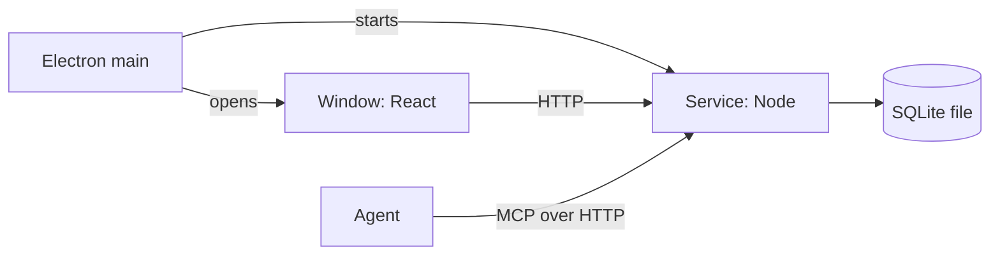

# Day local service

## Context

[Day](../../projects/day/README.md) keeps one person's work in one priority order. Two clients
must change that order: a desktop window, by drag and drop, and an agent, through
[MCP](https://modelcontextprotocol.io), the protocol agents use to call tools. A phone may become a
third. One command must start everything. The repository is public, so the data cannot live in it.

## Decision

One local process, the service, owns the database. Everything else is a client of it.

- Electron main starts the service inside Electron's own binary and opens the window, so one
  command starts everything and quitting the app stops everything.
- The service's entry point does not import Electron, so it can also run on its own.
- The service listens on the loopback address, which only this machine can reach, on a fixed port.
- The window calls the service over HTTP rather than Electron IPC, and holds no business logic.
- The service serves MCP over Streamable HTTP. Claude Code connects to the URL. Claude Desktop's
  chat starts local MCP servers itself, so it reaches the URL through the `mcp-remote` bridge, as
  the [WIDE README](../../projects/wide/README.md#claude-desktop) describes.
- The service stores items in one SQLite file in the user data folder, through Node's built-in
  `node:sqlite`.
- The window is sandboxed, with context isolation and no Node access.

This costs an HTTP API where Electron IPC would be less code, and a fixed port that another program
could already hold.

## Consequences

- An agent can change the list while the window is closed, as long as the app is running.
- The same React code can run in a browser, and a phone client needs no change to the service's
  design, only a way to reach it and to authenticate.
- No native module has to be rebuilt for each Electron version.
- The service needs a rule for one writer if it ever runs both inside the app and on its own.

## Alternatives considered

- **Logic and storage in the window.**
  [Super Productivity](https://github.com/johannesjo/super-productivity) and the desktop MCP server
  of [Logseq](https://github.com/logseq/logseq) forward each agent call to the window, so agents
  only work while it is open. [Joplin](https://github.com/laurent22/joplin) opens SQLite in the
  window and has to switch Node access on for it.
- **A core in an Electron utility process, reached over IPC.**
  [Actual](https://github.com/actualbudget/actual) does this and relays each message through main.
  It needs no port, but an agent or phone would still need a second, network API.
- **A stdio MCP server that opens the SQLite file itself.** It is less code, but the app and the
  MCP server would both write the file.
- **A native SQLite module such as `better-sqlite3`.** Actual and Joplin rebuild theirs for each
  Electron version. Logseq's database worker and
  [T3 Code](https://github.com/pingdotgg/t3code)'s server use `node:sqlite` instead.
- **Markdown files in a notes repository.** Notes tools could show them, but a global order is
  awkward to store and query.

## Reconsider when

- The fixed port clashes with another program: evaluate a discovered port or a stdio bridge.
- A second device needs access: decide on authentication and where the service runs.
- `node:sqlite` lacks something the data needs: evaluate a native module.

## References

- [T3 Code](https://github.com/pingdotgg/t3code): a Node server owns state, and desktop, web and
  mobile clients connect to it.
- [Logseq](https://github.com/logseq/logseq): its database worker is a Node process using
  `node:sqlite` that the window and CLI reach over loopback HTTP.
- [Signal Desktop](https://github.com/signalapp/Signal-Desktop): SQLite runs in worker threads,
  away from the window.
- [VS Code](https://github.com/microsoft/vscode): sandboxed windows call utility processes.
- [Electron process sandboxing](https://www.electronjs.org/docs/latest/tutorial/sandbox).
