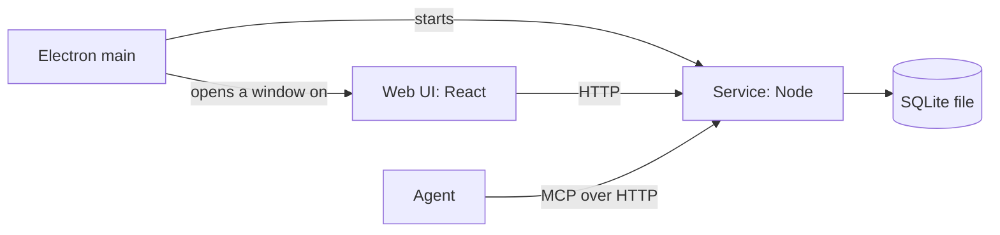

# Day local service

## Context

[Day](../../projects/day/README.md) keeps one person's work in one priority order. Two clients
must change that order: a desktop window, by drag and drop, and an agent, through
[MCP](https://modelcontextprotocol.io), the protocol agents use to call tools. A phone may become a
third. One command must start everything. The repository is public, so the data cannot live in it.

## Decision

One local process, the service, owns the database. Everything else is a client of it.

- Electron main starts the service as an Electron utility process, so one command starts
  everything and quitting the app stops it. The service does not import Electron, so it can also
  run on its own.
- The service listens on a fixed port on the loopback address, which only this machine can reach.
- The web UI and agents call the service over HTTP rather than Electron IPC. The web UI holds no
  business logic, and the service also serves it, so the page and the API share one origin.
- Agents reach the service through MCP over Streamable HTTP, the protocol's transport for a server
  that is already running.
- The service stores items in one SQLite file through Node's built-in `node:sqlite`.
- The API is [tRPC](https://trpc.io) with [zod](https://zod.dev) schemas, which the MCP SDK takes
  too, so the API and the agent's tools can share them.
- Each item's rank is a text key that sorts between its neighbours, from
  [`fractional-indexing`](https://github.com/rocicorp/fractional-indexing), so a move writes only
  the moved item, not every item renumbered between its old and new place.
- Bazel builds Day as an installable app for the one Mac it runs on, so it needs no release
  pipeline.

This costs an HTTP API where Electron IPC would be less code, and a fixed port that another program
could already hold.

## Consequences

- An agent can change the list while the window is closed, as long as the app is running. On
  macOS the app keeps running after its last window closes.
- The same React code can run in a browser, and a phone client needs no change to the service's
  design, only a way to reach it and to authenticate.
- No native module has to be rebuilt for each Electron version.
- The service needs a rule for one writer if it ever runs both inside the app and on its own.

## Alternatives considered

- **Logic and storage in the web UI.**
  [Super Productivity](https://github.com/johannesjo/super-productivity) and Logseq's desktop MCP
  server forward each agent call to the web UI, so agents only work while it is open.
- **A core reached only over Electron IPC.** [Actual](https://github.com/actualbudget/actual) does
  this. It needs no port, but an agent or phone would still need a second, network API.
- **A stdio MCP server that opens the SQLite file itself.** It is less code, but the app and the
  MCP server would both write the file.
- **A native SQLite module such as `better-sqlite3`.** It must be rebuilt for each Electron version.
- **GraphQL for the API.** It needs a schema and generated types that MCP tools could not reuse.

## Reconsider when

- The fixed port clashes with another program: evaluate a discovered port or a stdio bridge.
- A second device needs access: decide on authentication and where the service runs.
- `node:sqlite` lacks something the data needs: evaluate a native module.
- Day runs on a Mac that did not build it: decide on signing and updates.

## References

- [T3 Code](https://github.com/pingdotgg/t3code): a Node server owns state, and desktop, web and
  mobile clients connect to it.
- [Logseq](https://github.com/logseq/logseq): its database worker is a Node process using
  `node:sqlite` that the UI and CLI reach over loopback HTTP.
