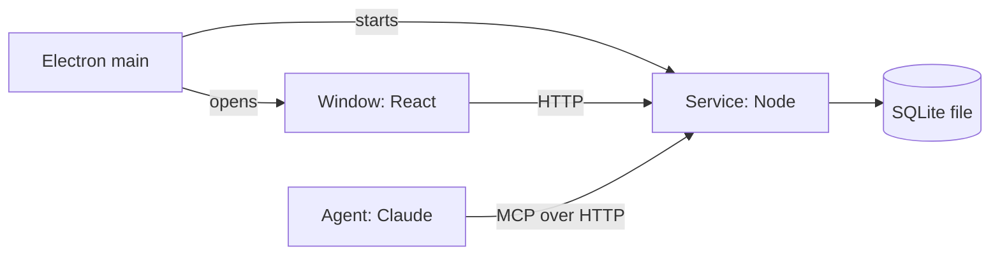

# Day architecture

Only the window exists so far. The rest of this page is the design the next changes follow.

## Shape

One local process, the service, owns the database. Everything else is a client of it.

- Electron main starts the service and opens the window, so one command starts everything and
  quitting the app stops everything.
- The service listens on the loopback address, which only this machine can reach.
- The window and agents use the same service, so there is one writer and both see the same order.

## Decisions

| Decision                                                              | Reason                                                                                                   |
| --------------------------------------------------------------------- | -------------------------------------------------------------------------------------------------------- |
| The service owns the data; the window holds no business logic.        | An agent can change the list without going through the window, and a phone client can be added later.    |
| The window talks to the service over HTTP, not Electron IPC.          | The same React code can run in a browser, and there is one API to build and test.                        |
| The service runs inside Electron's own binary, started by main.       | One install and one command, with no second runtime to ship.                                             |
| The service's entry point does not import Electron.                   | It can later run on its own, for example on a server that a phone reaches.                               |
| SQLite through Node's built-in `node:sqlite`.                         | A single file, and no native module to rebuild for each Electron version. Electron 45 bundles it.        |
| The database file lives in the user data folder, outside this repo.   | This repository is public and personal data must stay out of it.                                         |
| MCP is served over Streamable HTTP on a fixed port.                   | An agent's configuration is a stable URL, and the agent does not have to start a process.                |
| The window is sandboxed, with context isolation and no Node access.   | It runs like a web page, so a mistake in the UI cannot reach the file system.                            |
| A pnpm workspace of its own, built with electron-vite, outside Bazel. | Electron's packages stay out of the root lockfile that Bazel translates, as with the documentation site. |

## What other apps do

The shape follows open source Electron apps that have more than one client of their data.

| App                                                                    | Where its data lives                                             | What Day takes from it                                             |
| ---------------------------------------------------------------------- | ---------------------------------------------------------------- | ------------------------------------------------------------------ |
| [T3 Code](https://github.com/pingdotgg/t3code)                         | A Node WebSocket server that desktop, web and mobile connect to. | The server owns state and the desktop app bundles it.              |
| [Logseq](https://github.com/logseq/logseq), database version           | A Node process using `node:sqlite`, reached over loopback HTTP.  | The closest match: its window, CLI and MCP server share one owner. |
| [Actual](https://github.com/actualbudget/actual)                       | A core library in an Electron utility process.                   | A core that runs without Electron.                                 |
| [Super Productivity](https://github.com/johannesjo/super-productivity) | The window, with an MCP server that forwards each call to it.    | A caution: agents only work while the window is open.              |
| [Joplin](https://github.com/laurent22/joplin)                          | The window, with Node access switched on.                        | A caution: native SQLite modules need a rebuild for each release.  |
| [Signal Desktop](https://github.com/signalapp/Signal-Desktop)          | Worker threads, with every write going through one of them.      | One writer.                                                        |
| [VS Code](https://github.com/microsoft/vscode)                         | Utility processes that the sandboxed window calls directly.      | The sandboxed window.                                              |

## Not decided

- How rank is stored, so that moving one item does not rewrite every other item.
- Whether the loopback service needs a token.
- How the app is packaged for installing, rather than run from this folder.
- Whether Bazel builds and tests the project.
